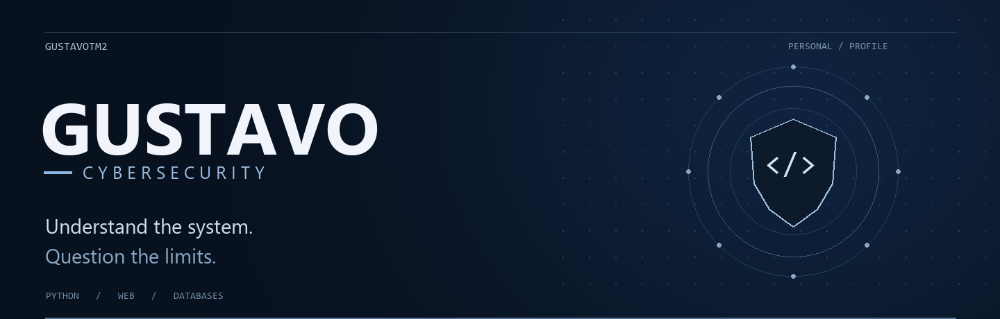
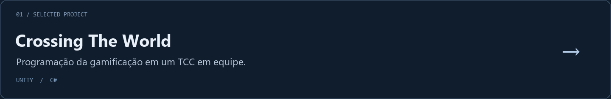

  

  <a href="#sobre">Sobre</a> &nbsp; / &nbsp;
  <a href="#tecnologias">Tecnologias</a> &nbsp; / &nbsp;
  <a href="#projeto">Projeto</a>

 

### Sobre

Meu foco é **cibersegurança**. Tenho conhecimentos em **Python**, desenvolvimento web e bancos de dados — e também passei pela programação de jogos em um projeto de equipe.

  

### Tecnologias

<table>
  <tr>
    <td><strong>Código &amp; web</strong>    Python · HTML · CSS · Java · JavaScript</td>
    <td><strong>Dados</strong>    MySQL · MongoDB</td>
  </tr>
</table>

 

### Projeto

<a href="https://github.com/GustavoTM2/TCC_Acrossing_the_World/tree/main/Docs">Documentação ↗</a>

