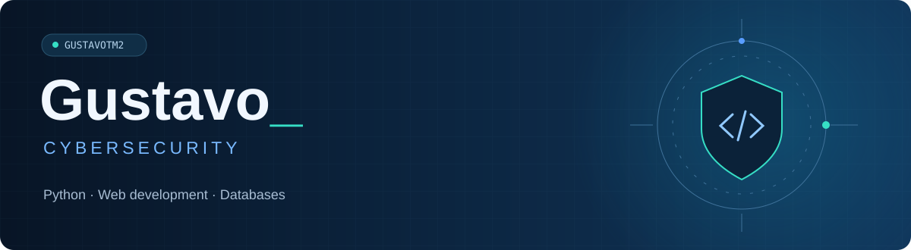

  

  

Foco em **cibersegurança**, com conhecimentos em Python, desenvolvimento web e bancos de dados.

 

### Tecnologias

  

Python · HTML · CSS · Java · JavaScript · MySQL · MongoDB

  

### Projeto

**[Crossing The World →](https://github.com/GustavoTM2/TCC_Acrossing_the_World)**  
Programação da gamificação em um TCC em equipe, com Unity e C#.
